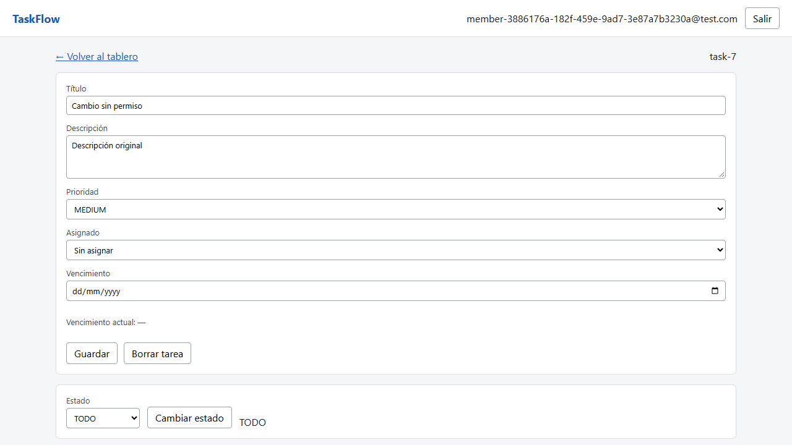

# BUG-01

**Título:** [Tareas] Un exmiembro puede editar una tarea desde el detalle abierto antes de su baja

**Criterio violado:** US-12 CA5: "Solo los miembros del proyecto al que pertenece la tarea pueden editarla (HTTP 403)".

**Entorno:** Windows 11 Home 10.0.26200 x64 · Chromium 156.0.8078.4 · Node v22.14.0 · Playwright 1.64.0 · cliente y servidor America/Montevideo (UTC-3) · commit 08a264a5edaea3b4ac3cfed5ef918123f95a9c1e. API local en 127.0.0.1:3101 y frontend en 127.0.0.1:5175; SQLite aislada.

**Datos / precondiciones:** Proyecto con owner y miembro; tarea asignada inicialmente al miembro. El miembro inicia sesión y deja abierto el detalle de la tarea. Los usuarios, proyectos y tareas son exclusivos de cada caso. Los identificadores concretos están en la evidencia HTTP.

**Pasos:**
1. Como owner, quitar al miembro mediante DELETE /api/projects/:projectId/members/:userId (204).
2. En la pantalla que el exmiembro dejó abierta, elegir Sin asignar para enviar un asignado válido (null).
3. Cambiar el título a Cambio sin permiso y pulsar Guardar.
4. Consultar la tarea como owner para comprobar su título persistido.

**Esperado:** PATCH /api/tasks/:taskId devuelve 403. El título original se conserva.

**Obtenido:** PATCH devuelve 200; el título cambia a Cambio sin permiso tanto en la pantalla del exmiembro como en la consulta posterior del owner.

**Reproducibilidad:** 2 de 2 veces por cada test indicado, en la ejecución final con --repeat-each=2. Comprobado en el entorno descrito; otros navegadores y zonas horarias no se evaluaron.

**Evidencia:**



[Respuestas HTTP completas](../evidencia-e2e/bug-01-permisos-respuestas-http.json) · [Entorno](../evidencia-e2e/bug-01-permisos-entorno.json)

Solicitud y respuesta observadas:

```json
[
  {
    "method": "PATCH",
    "path": "/api/tasks/task-7",
    "request": {
      "title": "Cambio sin permiso",
      "description": "Descripción original",
      "priority": "MEDIUM",
      "assigneeId": null,
      "dueDate": null
    },
    "status": 200,
    "body": {
      "id": "task-7",
      "projectId": "proj-7",
      "title": "Cambio sin permiso",
      "description": "Descripción original",
      "status": "TODO",
      "priority": "MEDIUM",
      "assigneeId": null,
      "dueDate": null,
      "createdAt": "2026-10-20T22:04:33.163Z",
      "updatedAt": "2026-10-20T22:04:33.756Z"
    }
  }
]
```

Los traces originales están en test-results/, asociados al test en el informe HTML de Playwright.

**Test que lo reproduce:**

- e2e/tests/us-12.spec.ts › error: un miembro quitado no puede editar desde una pantalla abierta [CA5]

**Severidad:** alta. Un usuario sin membresía vigente modifica datos de otro proyecto. Severidad alta por la pérdida de control de acceso.

**Causa identificada al revisar el código:** Las rutas PATCH /tasks/:taskId y su servicio no comprueban la membresía para editar los campos generales (server/src/modules/tasks/tasks.routes.ts y tasks.service.ts).
