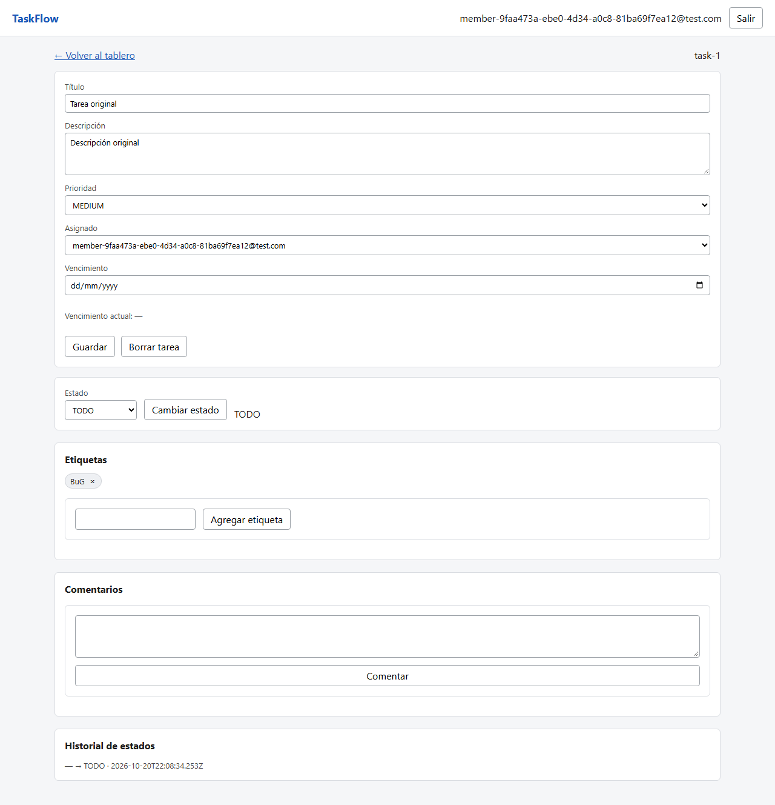

# BUG-02

**Título:** [Etiquetas] Se conservan las mayúsculas y BUG se agrega como una etiqueta distinta de bug

**Criterio violado:** US-15 CA1: "Las etiquetas se guardan normalizadas a minúsculas y sin espacios al inicio ni al final". CA2: "Las etiquetas no distinguen mayúsculas de minúsculas: 'Bug', 'BUG' y 'bug' son la misma etiqueta".

**Entorno:** Windows 11 Home 10.0.26200 x64 · Chromium 156.0.8078.4 · Node v22.14.0 · Playwright 1.64.0 · cliente y servidor America/Montevideo (UTC-3) · commit 08a264a5edaea3b4ac3cfed5ef918123f95a9c1e. API local en 127.0.0.1:3101 y frontend en 127.0.0.1:5175; SQLite aislada.

**Datos / precondiciones:** Miembro autenticado con una tarea sin etiquetas. Usar otra tarea vacía para comprobar la variante con distinta capitalización. Los usuarios, proyectos y tareas son exclusivos de cada caso. Los identificadores concretos están en la evidencia HTTP.

**Pasos:**
1. Agregar la etiqueta con texto "  BuG  " desde el detalle y consultar la tarea.
2. En otra tarea sin etiquetas, agregar bug y luego BUG.
3. Observar las etiquetas de la pantalla y de GET /api/tasks/:taskId.

**Esperado:** La primera etiqueta se guarda como bug. En el segundo caso hay una sola etiqueta bug; la variante BUG no crea otra etiqueta.

**Obtenido:** La primera etiqueta se guarda como BuG. Al agregar bug y después BUG quedan dos etiquetas, bug y BUG, y el segundo POST responde 201.

**Reproducibilidad:** 2 de 2 veces por cada test indicado, en la ejecución final con --repeat-each=2. Comprobado en el entorno descrito; otros navegadores y zonas horarias no se evaluaron.

**Evidencia:**

Las capturas de etiquetas se tomaron en una ejecución adicional de los mismos tres casos, con página completa para mostrar las etiquetas. Las respuestas HTTP pertenecen a la ejecución completa de dos repeticiones; los identificadores de las tareas cambian entre ejecuciones. Los traces adicionales están en test-results-capturas/.



[Respuestas HTTP completas](../evidencia-e2e/bug-02-normalizacion-respuestas-http.json) · [Entorno](../evidencia-e2e/bug-02-normalizacion-entorno.json)

[Captura del segundo caso](../evidencia-e2e/bug-02-mayusculas-duplicadas.png) · [HTTP del segundo caso](../evidencia-e2e/bug-02-mayusculas-duplicadas-respuestas-http.json)

Solicitud y respuesta observadas:

```json
[
  {
    "method": "POST",
    "path": "/api/tasks/task-18/tags",
    "request": {
      "name": "  BuG  "
    },
    "status": 201,
    "body": {
      "id": "tag-14",
      "name": "BuG"
    }
  }
]
```

Los traces originales están en test-results/, asociados al test en el informe HTML de Playwright.

**Test que lo reproduce:**

- e2e/tests/us-15.spec.ts › feliz: normaliza espacios y mayúsculas [CA1]
- e2e/tests/us-15.spec.ts › borde: repetir BUG devuelve 200 sin duplicar bug [CA2,3]

**Severidad:** media. La categorización depende de cómo se escriben las mayúsculas y las variantes consumen el cupo de etiquetas. Severidad media.

**Causa identificada al revisar el código:** addTag aplica trim sin toLowerCase y busca por el nombre exacto en server/src/modules/tasks/tasks.service.ts.
