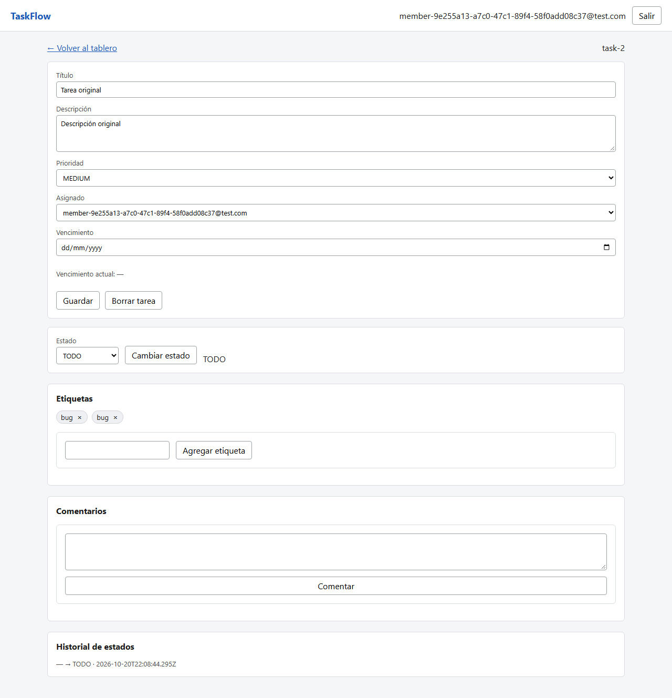

# BUG-03

**Título:** [Etiquetas] Agregar bug dos veces a la misma tarea crea un duplicado y devuelve 201

**Criterio violado:** US-15 CA3: "Una tarea no puede tener la misma etiqueta más de una vez; volver a agregarla devuelve HTTP 200 y no genera un duplicado".

**Entorno:** Windows 11 Home 10.0.26200 x64 · Chromium 156.0.8078.4 · Node v22.14.0 · Playwright 1.64.0 · cliente y servidor America/Montevideo (UTC-3) · commit 08a264a5edaea3b4ac3cfed5ef918123f95a9c1e. API local en 127.0.0.1:3101 y frontend en 127.0.0.1:5175; SQLite aislada.

**Datos / precondiciones:** Miembro autenticado y una tarea sin etiquetas. Los usuarios, proyectos y tareas son exclusivos de cada caso. Los identificadores concretos están en la evidencia HTTP.

**Pasos:**
1. Agregar la etiqueta bug desde el detalle (primer POST con 201).
2. Agregar nuevamente bug a la misma tarea.
3. Consultar la tarea y contar sus etiquetas.

**Esperado:** El segundo POST devuelve 200 y la tarea mantiene exactamente una etiqueta bug.

**Obtenido:** El segundo POST devuelve 201. La consulta y la interfaz muestran dos ocurrencias de bug, con el mismo identificador de etiqueta.

**Reproducibilidad:** 2 de 2 veces por cada test indicado, en la ejecución final con --repeat-each=2. Comprobado en el entorno descrito; otros navegadores y zonas horarias no se evaluaron.

**Evidencia:**

Las capturas de etiquetas se tomaron en una ejecución adicional de los mismos tres casos, con página completa para mostrar las etiquetas. Las respuestas HTTP pertenecen a la ejecución completa de dos repeticiones; los identificadores de las tareas cambian entre ejecuciones. Los traces adicionales están en test-results-capturas/.



[Respuestas HTTP completas](../evidencia-e2e/bug-03-duplicado-respuestas-http.json) · [Entorno](../evidencia-e2e/bug-03-duplicado-entorno.json)

Solicitud y respuesta observadas:

```json
[
  {
    "method": "POST",
    "path": "/api/tasks/task-19/tags",
    "request": {
      "name": "bug"
    },
    "status": 201,
    "body": {
      "id": "tag-15",
      "name": "bug"
    }
  },
  {
    "method": "POST",
    "path": "/api/tasks/task-19/tags",
    "request": {
      "name": "bug"
    },
    "status": 201,
    "body": {
      "id": "tag-15",
      "name": "bug"
    }
  }
]
```

Los traces originales están en test-results/, asociados al test en el informe HTML de Playwright.

**Test que lo reproduce:**

- e2e/tests/us-15.spec.ts › borde: repetir bug devuelve 200 sin duplicar bug [CA2,3]

**Severidad:** media. Se duplican asociaciones y se consume el límite de diez con valores repetidos. Es independiente de la falta de normalización: también ocurre repitiendo exactamente el mismo nombre. Severidad media.

**Causa identificada al revisar el código:** addTag crea una asociación taskTag sin comprobar si la tarea ya tiene esa etiqueta; el esquema tampoco impone unicidad para taskId y tagId.
