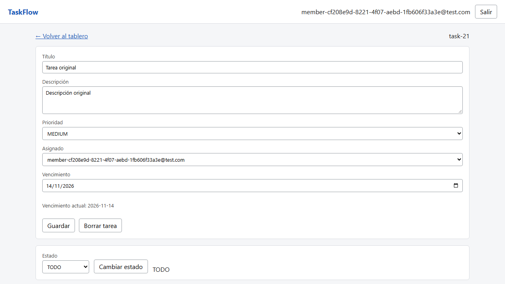

# BUG-04

**Título:** [Vencimiento] Guardar una fecha devuelve el día anterior cuando el servidor usa UTC-3

**Criterio violado:** US-16 CA3: "La fecha que se devuelve es siempre la misma que se cargó, sin importar la zona horaria del cliente ni la del servidor".

**Entorno:** Windows 11 Home 10.0.26200 x64 · Chromium 156.0.8078.4 · Node v22.14.0 · Playwright 1.64.0 · cliente y servidor America/Montevideo (UTC-3) · commit 08a264a5edaea3b4ac3cfed5ef918123f95a9c1e. API local en 127.0.0.1:3101 y frontend en 127.0.0.1:5175; SQLite aislada.

**Datos / precondiciones:** Miembro autenticado, tarea sin vencimiento, cliente y servidor configurados en America/Montevideo (UTC-3). Los usuarios, proyectos y tareas son exclusivos de cada caso. Los identificadores concretos están en la evidencia HTTP.

**Pasos:**
1. Abrir el detalle, seleccionar 2026-11-15 y pulsar Guardar.
2. Inspeccionar la respuesta del PATCH y consultar GET /api/tasks/:taskId.
3. Repetir en otra tarea con la fecha pasada 2020-01-01.

**Esperado:** PATCH, GET e interfaz conservan 2026-11-15. La fecha pasada se acepta y se devuelve como 2020-01-01.

**Obtenido:** PATCH responde 200 pero devuelve 2026-11-14; GET e interfaz muestran ese día anterior. Con la fecha pasada, el servidor devuelve y la pantalla muestra 2019-12-31. El valor enviado por el navegador es el día correcto.

**Reproducibilidad:** 2 de 2 veces por cada test indicado, en la ejecución final con --repeat-each=2. Comprobado en el entorno descrito; otros navegadores y zonas horarias no se evaluaron.

**Evidencia:**



[Respuestas HTTP completas](../evidencia-e2e/bug-04-fecha-respuestas-http.json) · [Entorno](../evidencia-e2e/bug-04-fecha-entorno.json)

[Captura del segundo caso](../evidencia-e2e/bug-04-fecha-pasada.png) · [HTTP del segundo caso](../evidencia-e2e/bug-04-fecha-pasada-respuestas-http.json)

Solicitud y respuesta observadas:

```json
[
  {
    "method": "PATCH",
    "path": "/api/tasks/task-21",
    "request": {
      "title": "Tarea original",
      "description": "Descripción original",
      "priority": "MEDIUM",
      "assigneeId": "user-62",
      "dueDate": "2026-11-15"
    },
    "status": 200,
    "body": {
      "id": "task-21",
      "projectId": "proj-21",
      "title": "Tarea original",
      "description": "Descripción original",
      "status": "TODO",
      "priority": "MEDIUM",
      "assigneeId": "user-62",
      "dueDate": "2026-11-14",
      "createdAt": "2026-10-20T22:05:24.310Z",
      "updatedAt": "2026-10-20T22:05:24.942Z"
    }
  }
]
```

Los traces originales están en test-results/, asociados al test en el informe HTML de Playwright.

**Test que lo reproduce:**

- e2e/tests/us-16.spec.ts › feliz: guarda el mismo día calendario en UTC-3 [CA1,2,3]
- e2e/tests/us-16.spec.ts › borde: acepta una fecha pasada y conserva el día [CA3,7]

**Severidad:** alta. La aplicación presenta vencimientos incorrectos, afectando la planificación y la interpretación de fechas pasadas. Severidad alta.

**Causa identificada al revisar el código:** parseDueDate interpreta YYYY-MM-DD como UTC, mientras formatDueDate usa getFullYear/getMonth/getDate en hora local (server/src/lib/ids.ts).
